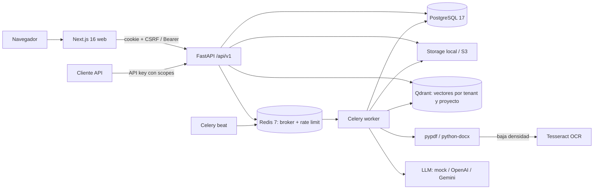

# DocMind AI — Auditoría de arquitectura (2026-11-10)

Rama `claude/docmind-ai-hardening-b0af16`, base `main` en `e7a0131`. Continúa `AUDIT_PRODUCTION_2026-10-27.md` y `DECISIONS_2026-10-30.md`, que siguen vigentes salvo donde este documento diga lo contrario.

**Jerarquía de evidencia:** (1) código y pruebas ejecutadas en esta sesión, (2) stack levantado en esta sesión, (3) documentación del repositorio, (4) notas de Obsidian. Lo que aquí figura como *verificado* se ejecutó el 2026-11-10 en Windows 11 + Docker Desktop 29.8 (12 CPU, 6 GB asignados a Docker), Python 3.12.10.

## 1. Arquitectura real

| Componente | Responsabilidad | Evidencia |
|---|---|---|
| `backend/app/main.py` (2 200 líneas) | Única frontera de autorización: 52 rutas, autenticación, tenancy, cuotas, exportaciones, `/ask` | `tests/test_tenant_isolation.py` recorre la tabla de rutas |
| `app/worker.py` | Procesamiento idempotente con bloqueo de fila, reintentos, recuperación de trabajos atascados | `tests/test_worker.py`, `test_reliability.py`, `test_celery_redis.py` |
| `app/ingestion/*` | Saneado PDF/DOCX, enmascarado PII, chunks por página, embeddings, Qdrant, respuestas extractivas | `test_ingestion.py`, `test_word_and_citations.py`, `test_case_query.py` |
| `app/evaluation/*` | Evaluación de extracción (precisión/recall/F1 por campo) y, desde hoy, de RAG | `docs/evaluation/*` |
| `frontend/` | Next.js 16 / React 19: login, documentos, revisión, esquemas, miembros, webhooks, `/ask` | lint + typecheck en esta sesión; Playwright no ejecutado hoy |

No hay Kubernetes ni microservicios, y no hacen falta: un monolito API + worker con Compose es proporcionado al producto.

## 2. Verificado en esta sesión

| Qué | Resultado |
|---|---|
| Suite backend (SQLite) antes de cambios | 577 passed, 35 skipped, cobertura 85 % |
| `ruff`, `mypy app`, `bandit -ll` | limpios |
| `pip-audit` | sin vulnerabilidades en dependencias de la app (solo el `pip` del venv local) |
| `docker compose up --build --wait` con `.env.example` | 6 servicios en marcha (db, redis, api, worker, scheduler, web), los 3 con healthcheck sanos, migraciones aplicadas — **primera vez que se completa** según el historial (antes: Docker Hub 429) |
| `scripts/staging_smoke.py` contra el stack | registro, subida, procesamiento, extracción, exportación y aislamiento A/B correctos |
| `POST /api/v1/ask` en el stack documentado | **`503 VECTOR_INDEX_DISABLED`** (defecto P0, ver §3) |
| Tras la corrección: `staging_smoke.py --ask` | respuesta con cita (documento, página, fragmento, extracto), abstención sin evidencia, aislamiento entre tenants |
| Copia y restauración de base + archivos | conteos iguales, SHA-256 idénticos, `reconcile` limpio (`docs/DEPLOYMENT.md`) |
| Evaluación RAG nueva | ver `docs/evaluation/rag-report.md` |

## 3. Hallazgos

### P0-1 — La consulta en lenguaje natural no funcionaba en el stack documentado (corregido, validado)

* `docker-compose.yml` no tenía servicio Qdrant y `.env.example` dejaba `QDRANT_URL` vacío, así que `/ask` y la página `/ask` respondían 503.
* Aunque se configurase `QDRANT_URL`, la imagen hacía `pip install .` sin el extra `qdrant`: `ModuleNotFoundError: qdrant_client` dentro del contenedor (comprobado).
* El embedder por defecto (`local`) necesita `fastembed` y archivos de modelo que la imagen no incluye.
* **Corrección:** servicio `qdrant/qdrant:v1.20.0` con volumen y healthcheck; imagen con `.[qdrant]`; `.env.example` con `QDRANT_URL=http://qdrant:6333` y `EMBEDDING_PROVIDER=hashing` para desarrollo (el código ya lo rechaza en staging/producción); el overlay de producción pone Qdrant en la red interna.

### P0-2 — `/ask` respondía sin evidencia suficiente (corregido, validado)

* La evaluación nueva mostró **abstención correcta del 50 %**: ante preguntas cuya respuesta solo existe en otra organización, `answer()` citaba una frase propia que compartía una única palabra genérica ("días", "deben"). No había fuga de datos (0 fragmentos ajenos), pero sí afirmaciones sin respaldo con una cita real, lo que es peor que abstenerse.
* **Corrección:** regla de evidencia suficiente: la frase citada debe cubrir ≥ `ASK_MIN_EVIDENCE_COVERAGE` (0,5) del peso de los términos de la pregunta. Resultado: abstención 1,0, sin perder ninguna pregunta factual; coste medido: 2 paráfrasis más se abstienen (falsas abstenciones del 5 % al 15 %).

### P0-3 — No existía evaluación de recuperación ni de citas (corregido, validado)

* Había evaluación de extracción, pero ninguna métrica Recall@K, MRR, exactitud de citas o abstención; la demo solo comprobaba 10 preguntas en top-1.
* **Corrección:** `app/evaluation/rag.py` + `eval_corpus/rag_questions.json` (6 documentos ficticios, 2 tenants, 28 preguntas en 4 categorías) sobre la ruta de producción (`retrieve()` y `answer()`); compuerta en CI y en pytest.

### P1 — Importantes

| # | Hallazgo | Estado |
|---|---|---|
| P1-1 | Las citas no permitían localizar el fragmento (solo documento y página) | **Corregido**: `chunk_index` y `excerpt` en la respuesta (aditivo) y en la UI `/ask` |
| P1-2 | La imagen backend usaba Python 3.14 (bump de Dependabot) y CI prueba en 3.12: producción ejecutaba un intérprete no probado | **Corregido**: imagen en 3.12; Dependabot ignora saltos menor/mayor de `python` |
| P1-3 | Copia de archivos nunca verificada | **Verificada en local**; S3/KMS siguen sin verificar |
| P1-4 | RLS sin implementar: el aislamiento depende solo de la aplicación | Pendiente (diseño aprobado en `RLS_DESIGN.md`, decisión 4) |
| P1-5 | Embedder de desarrollo léxico: las paráfrasis sin palabras comunes no se recuperan (recall de paráfrasis 3/4, respuestas 1/4) | Documentado; requiere modelo local o externo en producción, sin medir |
| P1-6 | `main.py` concentra 52 rutas en 2 200 líneas | Deuda; no bloquea |
| P1-7 | `/metrics` sin autenticación | Restringir en el ingress (ya documentado) |

### Lo que está bien y no se toca

Aislamiento multi-tenant probado ruta a ruta y en Qdrant (filtro dentro de la consulta), configuración que falla cerrada en staging/producción, cuotas con bloqueo de fila, outbox para borrado de vectores, exportaciones contra inyección de fórmulas, validación de subidas por magic bytes y rechazo de contenido activo.

## 4. Contradicciones con documentación y Obsidian

* La nota de Obsidian `1_Projects/DOCMIND_AI.md` dice "licencia MIT"; el repositorio es **propietario** desde `af9ca67` (`LICENSE`, `docs/LICENSING.md`). Manda el repositorio.
* El README afirmaba que el quick start permite "ask questions": no era cierto en Docker hasta este cambio.
* `docs/PRODUCTION_CHECKLIST.md` mencionaba `docker compose build` no completado: ya se completa.
