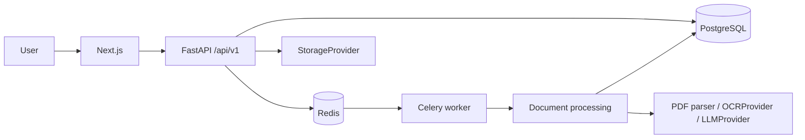

# Architecture

Modular monolith (ADR-001, ADR-005): one backend, one document model, one pipeline. Modules inside `backend/app/`:

| Module | Responsibility |
|---|---|
| `routers/` | HTTP API; the only authorization boundary |
| `ingestion/` | Sanitising, text/OCR, PII masking, page-bounded chunks, embeddings, Qdrant store, extractive answers |
| `rag/` | BM25, rank fusion, claim verification, named-term gate, conflicts, verified generation (from ContextRAG_Engine) |
| `conversations.py`, `routers/conversations.py` | Encrypted, private conversations |
| `worker.py`, `vector_index.py`, `retention.py`, `reconcile.py` | Asynchronous processing, indexing, deletion outbox, retention |
| `rls.py`, `security.py`, `project_access.py` | Tenancy: PostgreSQL RLS, authentication, case-level authorization |
| `evaluation/` | Extraction and RAG evaluation (`python -m app.evaluation.rag --corpus extended`) |

The question-answering flow is diagrammed in the README («Question answering»).

The API is the authorization boundary. Every organization-owned query receives an organization id derived from the authenticated principal; client-supplied organization ids never grant access. Workers reload the document version from the database and atomically claim jobs, making retries safe.

---
Relacionado: [[empresa]]
